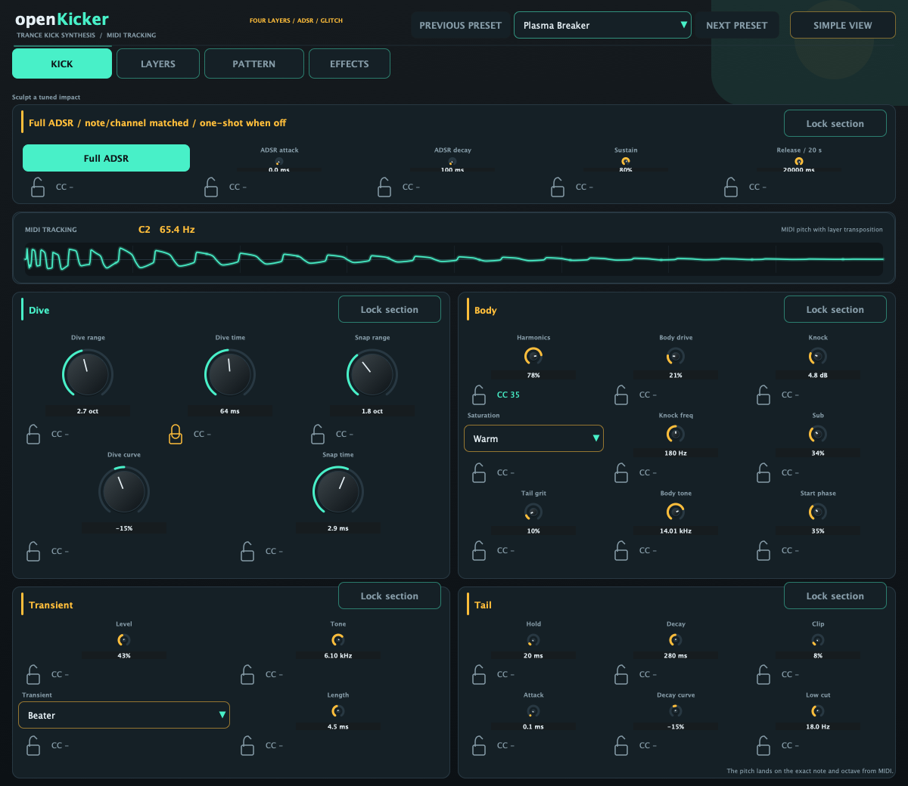
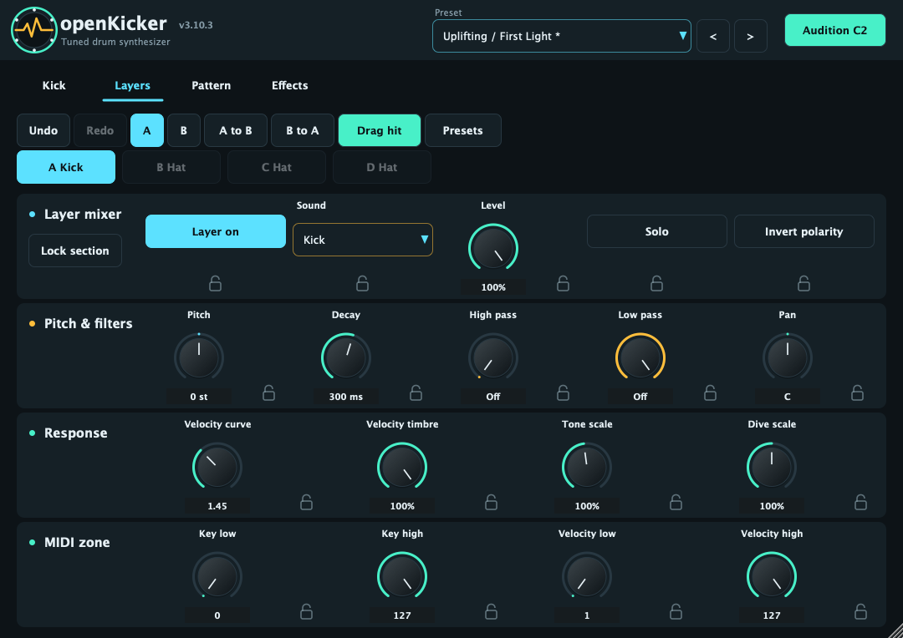
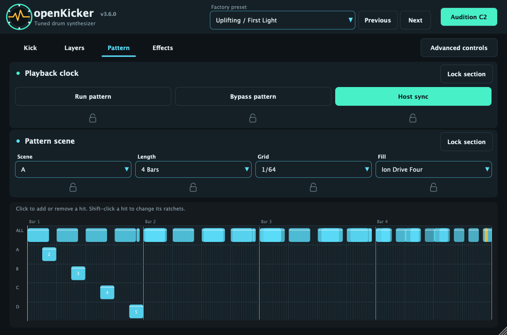
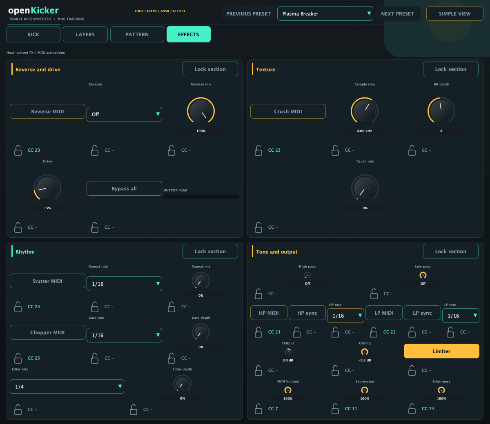

# openKicker v3.2.0

[Install with OpenVST Manager](https://github.com/alanmarcero/alan-m-OpenVSTManager/releases/latest)

openKicker is a MIDI-tuned kick and layered drum synthesizer. Four independently shaped layers, note-gated ADSR, and MIDI-controlled glitch effects share the tuned kick voice, pattern sequencer, and existing preset bank. Factory programs keep their one-shot behavior unless Full ADSR is locked on.

## Sound design

- **Dive:** Shape the pitch sweep and opening snap above the played note. The sweep always lands on that exact MIDI note.
- **Body:** Add upper harmonics, resonant knock, saturation, grit, tone shaping, and a clean sub layer for a harder trance impact.
- **Transient:** Choose a beater, noise, tick, or analog click, then set its tone and level.
- **Tail:** Shape the one-shot attack, hold, decay, curve, low cut, and clipping.
- **Waveform and note readout:** See the current MIDI note and its equal-tempered frequency alongside the live sound preview.
- **48 factory kicks:** The full bank is rebuilt for the new engine, from tight club impacts to longer, heavier trance tails.
- **Simple and advanced views:** Start with the controls that matter most, then open the full set for detailed sound design.

## Full ADSR

Enable **Full ADSR** on the Kick page for MIDI-gated sound. Attack and decay span 0–10,000 ms, sustain spans 0–100%, and release spans 0–20,000 ms. A matching note-off starts release from the current envelope level at its exact MIDI sample offset. Note and channel must both match. Eight sustained MIDI notes can overlap; retriggering the same note/channel restarts that voice, and the oldest note is stolen when all eight are busy. Auto Mode and audition keep a dedicated one-shot lane.

Full ADSR gates the kick body and generated snare, clap, and hat tails before shared effects. It is off by default; factory recall switches it off unless the enable control is locked. The original Tail controls remain the one-shot envelope. The waveform preview shows a finite one-shot reference. Host tail reporting follows remaining voice release, beat-repeat time, and a bounded shared-filter/sample-hold allowance, and returns to zero when those tails finish.

Tonal oscillators, pitch sweeps, knock, transient oscillators, and tuned-noise/filter paths now follow the incoming MIDI note plus each layer's transpose. Frequency controls use C2 as their reference, retaining the original C2 one-shot character. Broadband noise remains broadband; its tuned filtering follows the note. Frequencies stay below the sample rate's safe Nyquist limit.

## Drum layers

The **Layers** workspace has four pages, A through D. Each layer can be enabled or muted and set to Kick, Snare, Clap, or Hat. Set the level, pitch, decay, high-pass, and low-pass on each page. The filters run on their own layer before the voices are mixed into one hit. Layer A starts as an enabled kick; B, C, and D start muted with Snare, Clap, and Hat selected.

Each layer has inclusive MIDI key and velocity limits. Reversed limits reject all notes. Velocity curve sets the amplitude exponent (0.1–4, with the original 1.45 response as default); Velocity timbre blends between fixed full-hit tone and velocity-sensitive drive/transients. These settings act independently on each layer.

The pitch control transposes its layer. Tone scale shifts its body/transient filter frequencies. Drive offset adds to the main kick drive, and shapes snare, clap, and hat voices independently. Sweep scale adjusts a kick layer's pitch dive and snap. Neutral offsets retain the main synthesis settings; layer decay still scales the main kick decay.

Solo auditions enabled layers; multiple solos can play together. Pan places each layer before the stereo FX, and Invert reverses its polarity. Center pan preserves the original dual-mono level. Mono output averages the stereo layer mix.

## MIDI

The kick voice follows the incoming note's equal-tempered pitch, including its octave. For example, MIDI A4 (note 69) plays at 440 Hz; A3 (note 57) plays at 220 Hz. The layer pitch control transposes that note for an individual layer. Note-off does not stop a one-shot; Full ADSR uses matched note/channel note-offs. An audition click plays C2.

Velocity shapes the hit level and kick drive, so soft hits have less weight and hard hits gain extra bite. MIDI input is omni-channel. The callback accepts up to 65,535 supported MIDI events plus one audition per block; excess events are ignored to keep storage bounded. The default performance bindings are shown below and beside their controls. Values 64–127 activate a MIDI switch; values 0–63 deactivate it. MIDI activations are separate from the existing automated effect amounts and HP/LP sync switches. Their host parameters are automatable and saved; incoming CC values use a separate display/DSP mirror and leave host automation values intact. Every binding can be reassigned or cleared:

| CC | Name | Effect |
| --- | --- | --- |
| 7 | Volume | Output trim multiplied by the Output control |
| 11 | Expression | Additional output trim |
| 20 | Sync Reverse | Starts a reversed hit on the next note-on, ending at the next quarter-note boundary. A note exactly on a beat gets one full beat. |
| 21 | Sync High Pass | Enables the host-synced high-pass sweep. |
| 22 | Sync Low Pass | Enables the host-synced low-pass sweep. |
| 23 | Crush MIDI | Activates bitcrush and sample-rate reduction. |
| 24 | Stutter MIDI | Arms host-synced repeats from note-on until the next quarter-note boundary. |
| 25 | Chopper MIDI | Activates the host-synced gate. |
| 74 | Brightness | Sets the effective low-pass ceiling |
| 120 | All Sound Off | Stops the current hit |
| 121 | Reset Controllers | Clears CC overrides back to host values and resets performance controllers |
| 123 | All Notes Off | Ignored; use matched note-offs in Full ADSR, or CC120 for immediate silence |

## Preset locks and MIDI assignment

Click a parameter's padlock to protect it while browsing factory programs. **Lock section** protects exactly that card's controls; clicking again unlocks a fully locked section. Locks preserve the latest edit, rather than an older frozen value. Direct edits, host automation, and MIDI control remain available.

Right-click a control or its CC badge to open **MIDI CC**. Choose Unassigned, any CC from 0 through 127, or Restore factory assignment. Multiple parameters may share a controller; continuous, stepped, choice, and toggle parameters use their own ranges and quantization. New sound/envelope assignments start unassigned. Locks and bindings save by parameter ID with the session; full project restore restores project values even when the current instance has locks. MIDI overrides are transient and never write host automation from the audio callback.

Incoming controllers apply at their sample offsets and retain input order against notes. Frequency/envelope/velocity settings latch on note-on, while FX, output trim, layer mute/solo/pan/polarity, and clock settings use the live routed values. Temporary fill/length CC overrides do not replace saved custom patterns. Editing a displayed temporary pattern commits that fill/length as a direct edit before changing its notes. MIDI command CC120/121/123 retain their existing command behavior even when also assigned to a parameter.

## Pattern sequencer

Four independent pattern scenes, A/B/C/D, have separate length, fill, grid, tail trim, and bitcrush ramp. Each piano roll contains an **ALL** lane plus separate **A–D layer lanes**. Factory patterns and older sessions use ALL, triggering every enabled layer at the step velocity. Click a layer lane to add or remove a hit for that layer only; Shift-click an existing hit to cycle its ratchets from 1 to 8. Ratchets divide the hit's grid length evenly, including triplets. Explicit layer hits take priority over simultaneous ALL hits for the same layer. Lane edits and ratchets are saved with the session. Changing a scene's fill or length reloads its factory pattern. Internally generated hits use C2; incoming MIDI notes still trigger at their exact pitch. The 28 trance fills and every preset have been authored for the current kick engine.

Auto Mode follows host tempo, meter, and playhead, or runs from its own tempo and time signature. Tail trim shortens fast rolls in Auto Mode. It does not change incoming MIDI hits.

## Effects

The FX page includes host-synced reverse, high-pass and low-pass sweeps, drive, bitcrushing, beat stutter, gate, filter pump, output trim, peak meter, and a zero-latency limiter. Reverse mode and the HP/LP sync switches and rates are automatable. The MIDI reverse activation always ends at the next quarter-note beat; legacy automated reverse modes retain their subdivisions. Reverse uses bounded streaming synthesis with a backward pitch/envelope trajectory and a short end fade; it does not render a complete hit inside the audio callback. Its filtered/noise waveform can differ from the former cached reversal. Reverse and stutter follow host timing across tempo changes. Crush, Stutter, and Chopper MIDI activations use a nonzero Mix/Depth setting, or full activation when that amount is zero; switching the MIDI activation off returns to the original automated amount. CC20–CC25 activate the matching reverse, filter, crush, stutter, and gate modes during performance. Filter sync rates range from 1/4 to 1/64.

## Sessions and compatibility

The plug-in identity remains openKicker. Version 3.2 adds optional note-tracked Full ADSR with eight sustained MIDI notes, per-parameter MIDI CC assignments and locks, and MIDI activation for the host-synced glitch modes. Version 3.1 introduced the saved layer and sync-effect parameters. Older sessions load matching controls and use the new default layer setup for parameters they do not contain.

## Native editor

The editor uses shared graphite surfaces with mint focus/primary controls and amber secondary controls. These captures come from the compiled JUCE editor:






Reproduce them with `cmake --build build --target openedmkick_screenshots --config Release`. See [capture notes](docs/SCREENSHOTS.md).

## Build

The project uses C++20 and JUCE 8.0.9. It builds VST3, AU, LV2, and Standalone formats on macOS; VST3, LV2, and Standalone on Windows and Linux.

```sh
cmake -S . -B build -DCMAKE_BUILD_TYPE=Release
cmake --build build --target OpenEDMKick_Standalone --config Release --parallel
cmake --build build --config Release --parallel
ctest --test-dir build -C Release --output-on-failure
```

## Source layout

- `Source/Core`: Synth, Auto Mode sequencer, effects, and audio engine.
- `Source/Plugin`: Parameters, presets, JUCE processor, custom controls, and editor pages.
- `Tests`: Existing Catch2 checks used by the GitHub Actions build.
- `docs`: Audio behavior, compatibility, and design notes.
