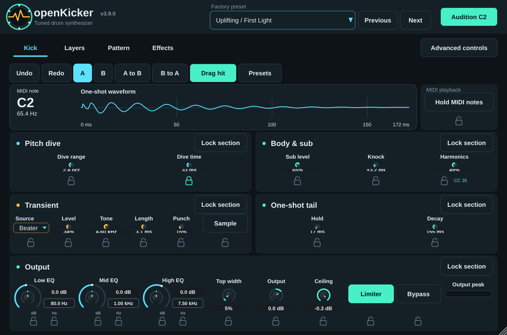
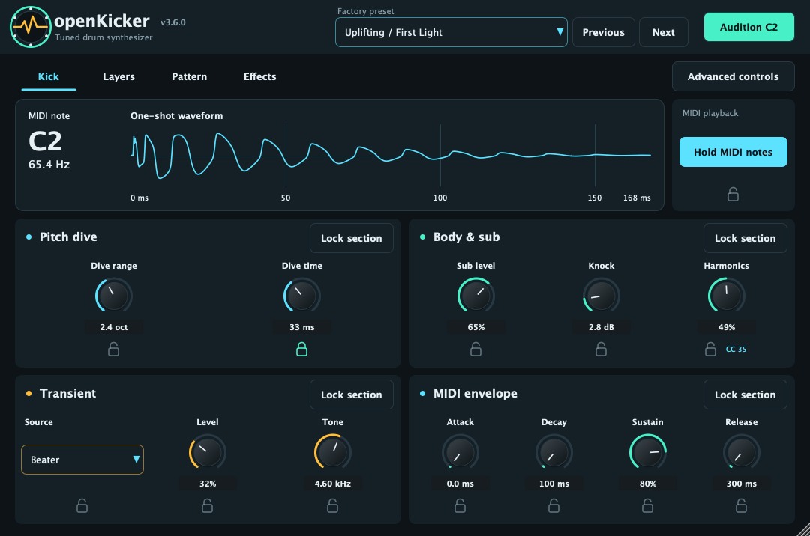

# openKicker v3.9.0

[Install with OpenVST Manager](https://github.com/alanmarcero/alan-m-OpenVSTManager/releases/latest)

## Beta

All of these plugins are in beta. The macOS and Linux builds are not up to date, so the Windows build is the one to use for now. A plugin can change dramatically from one release to the next, but the goal is for each one to keep getting better.

openKicker makes pitched trance kicks and layered drum hits. Play it from a MIDI keyboard or sequence. MIDI notes set the kick pitch and octave. Add up to four kick, snare, clap, or hat layers to create a complete hit.

The drum badge pulses on each quarter note. It follows the host playhead, tempo changes, and loop jumps, or the internal clock in standalone playback.

## Shape the kick

Choose a style under **Factory preset**, then press **Audition C2** to hear a hit. **Previous** and **Next** step through the bank from any page. The 56 factory kicks come in six dance styles: 16 Uplifting and eight each of Rolling, Progressive, Psy, Tech, and Classic. Try *First Light* for a firm beater, *Velvet Sub* for a soft attack, or *Triplet* for a running bass line.

Drag **Drag hit** onto a track or the desktop to bounce the last note and velocity, including layers and the effect tail, as a WAV.

**Sample**, on the Kick page, adds an optional click from a short WAV or from the built-in Tick, Beater, Wood, and Snap sounds. It stays off until you enable it, so older sessions and factory presets sound the same. Level, start, pitch, and high-pass are under **Advanced controls**. The sample is saved inside the project.

**Undo** and **Redo** step through control changes. Use Cmd+Z or Ctrl+Z, and Shift+Cmd+Z or Shift+Ctrl+Z to redo. **A** and **B** keep two full sounds. **A to B** and **B to A** copy between them. **Presets** searches the factory bank and the sounds you save. You can star a preset, and save, rename, or delete your own. Factory presets stay read-only. Your files go in Documents/Alan Marcero/openKicker/Presets.

On the **Kick** page, **Pitch dive** sets how quickly the pitch drops to the played note. Adjust **Body & sub** for low-end weight, **Transient** for the attack, **One-shot tail** for the space before the bass enters, and **Output** for the dual-layer 3-band EQ (±12 dB inner cap, smoothly gliding outer frequency collar), **Top width**, **Output**, **Ceiling**, **Limiter**, **Bypass**, and **Output peak** meter. The waveform shows the length of the hit in milliseconds. Factory kicks use 10–23 ms of hold and 105–168 ms of decay.

Switch on **Hold MIDI notes** beside the waveform to play openKicker as a pitched synthesizer. The Kick page shows attack, decay, sustain, and release. Hold a chord on your keyboard and release each note independently. **Audition C2** and the sequencer play one-shots. **Advanced controls** exposes both envelopes, filters, and snap.

The clean sub starts at the played pitch and blends into the body's phase as the dive settles. This keeps the low end consistent as you change notes. **Knock** now boosts its selected frequency band cleanly without adding distortion.

## Add drum layers

The **Layers** pages A–D each add a Kick, Snare, Clap, or Hat voice. Set level, pitch, decay, and filters for each layer. Key and velocity ranges choose which notes activate it. Set the velocity response and timbre, then adjust tone and pitch-sweep offsets. Solo, pan, or invert layers to shape the mix.

## Play and automate

Velocity changes the hit level and tone. Notes follow their MIDI pitch; the layer pitch control can transpose each voice. Right-click a control to assign or clear its MIDI CC. The default CCs control output volume (7), expression (11), reverse (20), high-pass sync (21), low-pass sync (22), crush (23), stutter (24), chopper (25), and brightness (74). CC 120 stops the sound and effect tails. CC 121 resets controller overrides. With **Hold MIDI notes** enabled, a matching note-off starts the release stage.

Protect a section with its lock while browsing presets. Locked controls stay editable, and the lock state saves with the project.

## Make patterns

The pattern sequencer has four scenes, A–D. Each scene has its own pattern, length, fill, grid, tail trim, and bitcrush ramp. Use the ALL lane to trigger every enabled layer or edit separate lanes for each layer. Add up to eight ratchets to a step. Auto Mode follows the host tempo, meter, and playhead, or runs at a tempo and meter you set. It can play the 28 built-in trance fills.

## Add effects

Use the Effects page for reverse, high-pass and low-pass sweeps, bitcrushing, stutter, gate, and filter pump. Reverse, stutter, and filter sweeps can follow host timing. MIDI CCs can activate the glitch effects while you play.

## More screenshots

## Formats and license

VST3, AU, LV2, and Standalone formats are available on macOS. Windows and Linux versions include VST3, LV2, and Standalone. Older openKicker sessions recall their saved sound and appear as **Custom sound**. Any missing controls take their default values.

MIT License. See [LICENSE](LICENSE).
