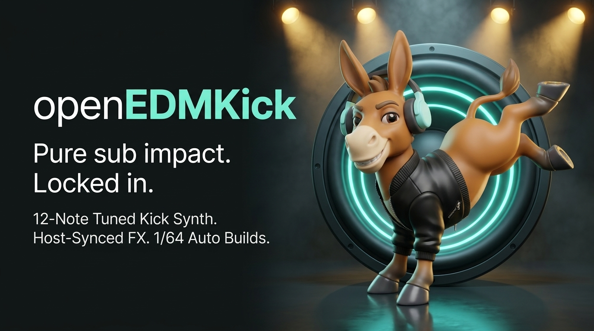
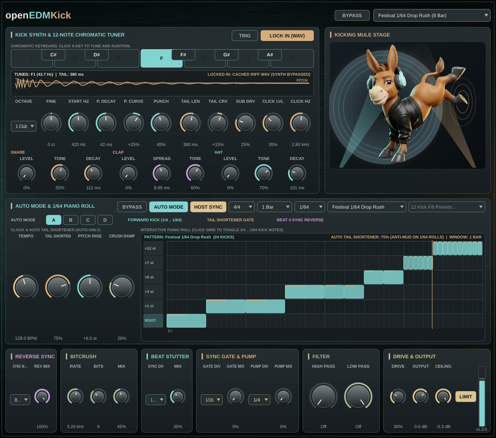
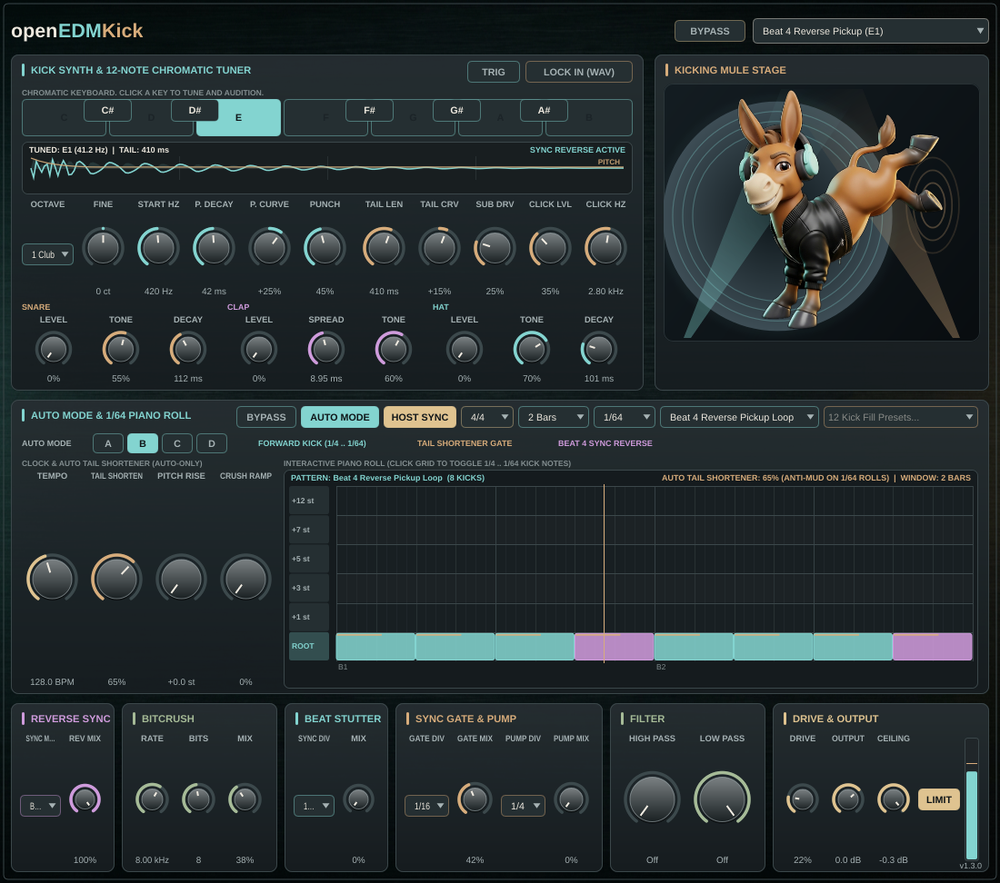

# openEDMKick

[Install with OpenVST Manager](https://github.com/alanmarcero/alan-m-OpenVSTManager/releases/latest)

EDM kick drum VSTi with 12-note chromatic tuning, a Lock In WAV cache, host-synced reverse and effects, and A/B/C/D Auto Mode with a 1/64-note piano roll and Tail Shortener. Packages include VST3, LV2, and a standalone app on macOS, Windows, and Linux. macOS also includes AU.



## Screenshots

### 1/64-note drop build, Auto Mode A



### Beat 4 reverse pickup, Auto Mode B



*Captured from the native v1.3.0 editor. [Capture details and provenance](docs/SCREENSHOTS.md).*

## Features

- Regular Mode (`IS_SYNTH`): any MIDI note triggers the kick at its tuned fundamental.
- Snare, clap, and hat layers mix into that hit. Levels default to off. Modifiers are snare tone and decay, clap spread and tone, and hat tone and decay. They follow velocity, semitone offset, Lock In, and the waveform preview. Tail Length still ends the voice. Details are in [docs/AUDIO.md](docs/AUDIO.md).
- Tuning runs C through B, octaves `0 Sub`, `1 Club`, and `2 Punch`, with fine tune from -50 to +50 cents. Pitch controls are `Start Hz`, `Pitch Decay`, and `Pitch Curve`. Body controls are `Tail Length`, `Tail Curve`, `Sub Drive`, and `Punch`. Click controls are `Click Level` and `Click Freq`. The gold trace is the pitch drop.
- `LOCK IN (WAV)` stores the kick as an internal 32-bit float RIFF WAV and plays that buffer. The WAV is saved in the session. A host sample-rate change resamples it.
- Reverse Sync modes are `Off`, `Beat End (Sync)`, `Beat 4 Auto`, `1/2 Beat`, and `1/4 Beat`. A hit on beat 4 ends at the bar line.
- Bitcrush has `Rate` (200 Hz to 48 kHz), `Bits` (1 to 16), and `Mix`. Auto Mode can raise the mix with Crush Ramp.
- Beat Stutter repeats the hit on host divisions from 1/4 to 1/64.
- Sync Gate and Filter Pump use the same divisions.
- Drive is level-compensated `tanh`. The limiter reports 0 samples of latency and drops gain on the sample that crosses the ceiling.
- High Pass and Low Pass are 12 dB/oct, with no resonance. They run after the hit, the snare, clap, and hat layers, and the other effects, and before the limiter. Minimum high pass and maximum low pass are off. Cutoff moves are smoothed. Lock In stores the hit before these filters. Playback and the waveform preview still apply the current cutoffs.
- Auto Mode slots A, B, C, and D hold separate patterns. Switch them in the UI or on the `Auto Mode` automation lane, as in openEDMFilter.
- Pattern length is 1, 2, 4, 8, 16, 32, or 64 bars.
- Fill presets: `Four on the Floor + End Fill`, `Classic EDM Build (1/4 -> 1/32)`, `Festival 1/64 Drop Rush`, `Tech House Groove & Turnaround`, `Big Room Drop Countdown`, `Hardstyle Pitch-Up Build`, `Future Rave Syncopated Fill`, `Halftime to 1/32 Blaster`, `Beat 4 Reverse Pickup Loop`, `Accelerating Exponential Roll`, `Offbeat Stomp & 1/64 Finale`, and `Mainstage 64th Machine Gun`.
- The piano roll edits triggers and pitch from `ROOT` to `+12 st`, down to a 1/64 note.
- Tail Shortener runs in Auto Mode only. It shortens tails on 1/16, 1/32, and 1/64 rolls. Regular Mode keeps the full tail. The roll labels this Anti-Mud on 1/64 rolls.
- Kicking Mule Stage draws the Kick Mule in front of a subwoofer cone and spotlights that follow the output and the host beat.

## Engine notes

Sessions from v1.0.0 and v1.1.0 still load. Layer levels default to 0, so an old session stays a dry kick until those knobs move. Layers at 0 match the v1.1.0 oscillator. Unlocked projects differ from v1.0.0 because that oscillator changed. A Lock In WAV is restored as stored.

- The pitch drop is exponential and reaches the tuned note at the end of Pitch Decay. A positive Pitch Curve falls faster.
- Tail Curve is exponential. Positive values decay faster.
- The click is a chirp plus a deterministic noise tick. Live playback matches Lock In.
- Retrigger fades the previous sample over about 0.45 ms.
- Host Sync on: Auto Mode runs while the host is playing. TRIG still auditions the kick. Host Sync off: the internal clock runs.
- Default F1 kick at 48 kHz: settled pitch 43.67 Hz, fundamental 43.65 Hz, DC about `-7e-6`, peak `-0.89`, no full-scale samples. See [docs/AUDIO.md](docs/AUDIO.md).

## Build

```sh
cmake -S . -B build -DCMAKE_BUILD_TYPE=Release
cmake --build build --config Release --parallel
ctest --test-dir build -C Release --output-on-failure
```

## Layout

- `Source/Core`: Pure C++20 DSP with no JUCE dependency (`KickSynth`, `AutoSequencer`, `Effects`, `KickEngine`).
- `Source/Plugin`: JUCE processor, parameters, presets, custom look-and-feel, piano roll, and editor panels.
- `Tests`: Deterministic Catch2 unit and plugin tests.
