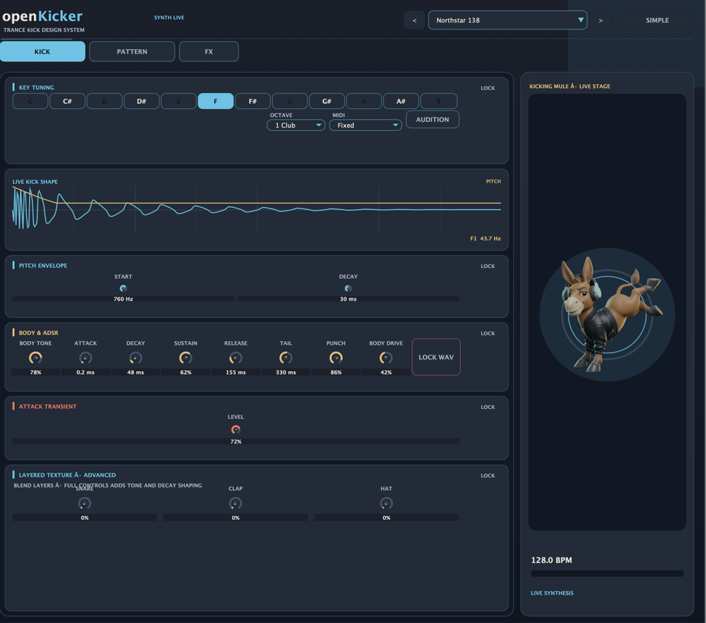
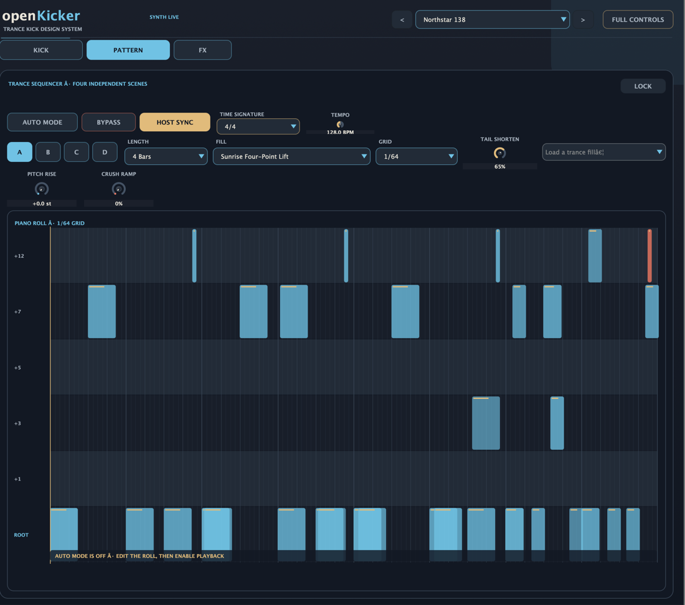
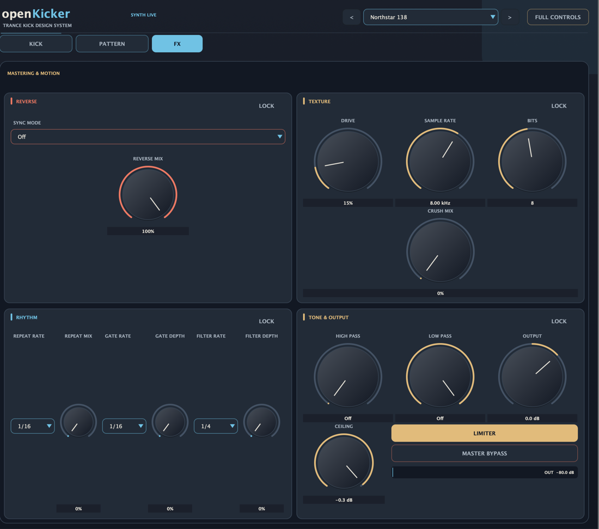

# openKicker v2

[Install with OpenVST Manager](https://github.com/alanmarcero/alan-m-OpenVSTManager/releases/latest)

openKicker is a chromatic trance kick synthesizer and pattern instrument. Version 2 replaces the synth engine, sequencer, effects engine, preset banks, and native editor. The new harmonic body, punch transient, and one-shot ADSR are tuned for clear, forceful dance and trance kicks.

## V2 screenshots

| Kick design | Pattern sequencer | Effects |
| --- | --- | --- |
|  |  |  |

All three images are captured from the native JUCE editor. See [screenshot notes](docs/SCREENSHOTS.md).

## Sound design

- **Harmonic kick body:** Tune the kick through 12 notes and three octaves. Shape the pitch drop and body harmonics, then add drive, punch, and an adjustable click transient.
- **One-shot ADSR:** Set attack, decay, sustain, and release. Tail Length bounds the body duration; Tail Curve shapes its decay. The existing snare, clap, and metallic hat layers remain available in Full Controls.
- **48 new factory kicks:** Every factory sound is newly authored for trance. No factory preset from the earlier implementation is retained. Browse from the preset menu or use previous/next.
- **Section locks:** Lock Tuning, Pitch, Body & ADSR, Transient, Layers, Auto Mode, Reverse, Texture, Rhythm, or Tone & Output. Preset changes skip every parameter in a locked section. Locks are stored in the session.
- **Simple and Full Controls:** Simple View keeps the core shaping controls visible. Full Controls reveals detailed pitch, click, layer, sequencer, and effect parameters.
- **Lock WAV:** Freeze the current synthesized hit as an internal 32-bit float WAV. It remains available in the saved session and is resampled when the host sample rate changes. Effects and filters continue to process the frozen hit.
- **Kicking Mule stage:** A live stage view follows the kick output and beat phase.

The V2 kick bank is: Northstar 138; Violet Horizon; Euphoric Striker; Stadium Bloom; Rise Through Light; Eternal Gate; Skybreaker 140; Aether Drive; Solstice Anthem; Last Dawn 138; High Orbit Slam; Mainline Euphoria; Sundial Trance; Orbit Assembly; Chrome Dawn 909; Rave Hall Vintage; Tape Echo 138; Iron Bloom 909; Neon Basement 132; Dry Room Driver; Glass Transistor; Analog Gate 138; Rotor Wash Anthem; Nightline 909; Chroma Drive; Mirrorball Impact; Voltage Parade; Forest Vector 145; Carbon Triplet; Spiral Resin; Red Dust Pulse; Psy Meridian 148; Wormhole 144; Acid Lantern; Triad Runner; Moss Engine; Obsidian Needle; Saffron Spiral; Feral Current; Amber Vortex; Hard Circuit 145; Voltage Cathedral; Steel Anthem 142; Front Row Impact; Burner 150; Edge of Orbit; Peak Signal 138; and Final Beacon.

## Pattern sequencer

- Four independent patterns, A/B/C/D, with separate length, fill, grid, Tail Shortener, pitch rise, and crush ramp settings.
- 28 new trance-focused fills. Each fill has new note content and a new name.
- Edit triggers and pitch in the piano roll down to 1/64-note resolution. Pattern lengths are 1, 2, 4, 8, 16, 32, or 64 bars.
- Follow host tempo, meter, and playhead, or use the internal tempo and time signature. Auto Mode bypass and audition triggers remain available.
- Tail Shortener trims fast rolls in Auto Mode to keep consecutive hits clear. It does not change Regular Mode MIDI hits.

## Effects

- Host-synced reverse modes: Off, Beat End, Beat 4 Auto, half beat, and quarter beat.
- Drive, bitcrusher, beat stutter, sync gate, rhythmic filter pump, high-pass and low-pass filters, output trim, peak meter, and zero-latency limiter.
- Auto Mode can ramp pitch and bitcrush intensity across a build.
- Simple View provides the main controls; Full Controls reveals crusher rate/bit depth and filter-pump timing.

## MIDI

MIDI input is omni-channel. Note-off and sustain pedal do not stop a kick; each hit is a one-shot. A note-on with velocity zero is treated as note-off.

- **Fixed:** Every note plays the current tuned kick.
- **Note Tracking:** The MIDI note transposes the tuned root, up to ±48 semitones. Fine tuning stays on the root. Octave 0 C, Octave 1 C, and Octave 2 C are MIDI 12, 24, and 36. Octave 1 F is MIDI 29. MIDI 60 is C4.
- **Audition:** The Audition button plays the tuned root, including while Auto Mode is running.
- **Velocity:** Scales the kick, layers, and frozen WAV.

Performance controllers are not saved and do not write automation parameters:

| CC | Name | Effect |
| --- | --- | --- |
| 7 | Volume | Output trim multiplied by the Output control |
| 11 | Expression | Additional output trim |
| 74 | Brightness | Sets the effective low-pass ceiling |
| 120 | All Sound Off | Stops the current hit |
| 121 | Reset Controllers | Resets Volume, Expression, and Brightness |
| 123 | All Notes Off | Ignored; one-shot hits continue |

Other controllers, including sustain, are ignored.

## Sessions and compatibility

V2 keeps the plugin identity, host parameter IDs, and existing parameter values, so older sessions can restore their sound settings. A session from an earlier preset catalog is marked as a custom sound. Its old factory preset selection is not reused; all 48 factory entries and all 28 fill patterns are new. Lock WAV data is restored as stored.

## Build

The project uses C++20 and JUCE 8.0.9. It builds VST3, AU, LV2, and Standalone formats on macOS; VST3, LV2, and Standalone on Windows and Linux.

```sh
cmake -S . -B build -DCMAKE_BUILD_TYPE=Release
cmake --build build --target OpenEDMKick_Standalone --config Release --parallel
```

## Source layout

- `Source/Core`: Synth, Auto Mode sequencer, effects, and audio engine.
- `Source/Plugin`: Parameters, presets, JUCE processor, custom controls, and editor pages.
- `Tests`: Existing Catch2 checks used by the GitHub Actions build.
- `docs`: Audio behavior, V2 design spec, and screenshot notes.
