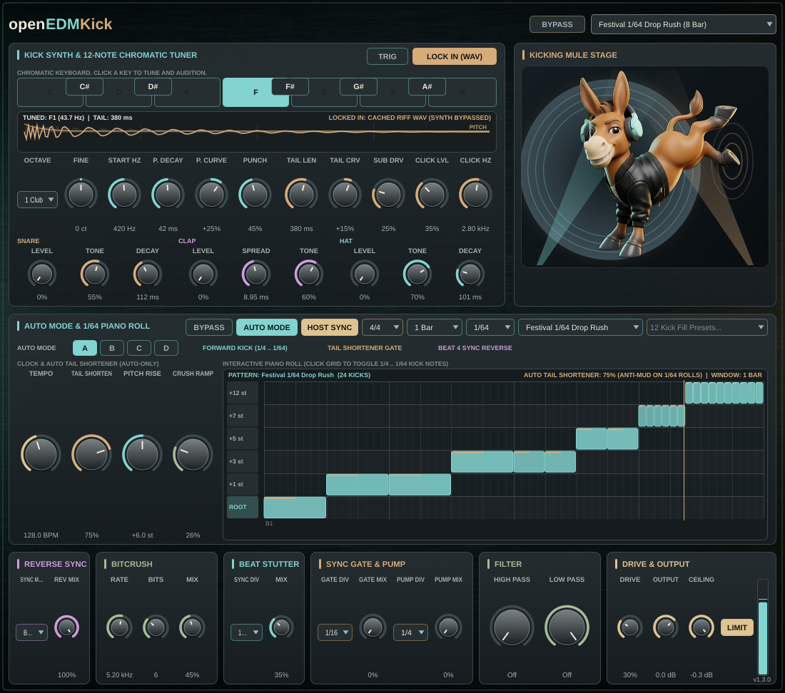
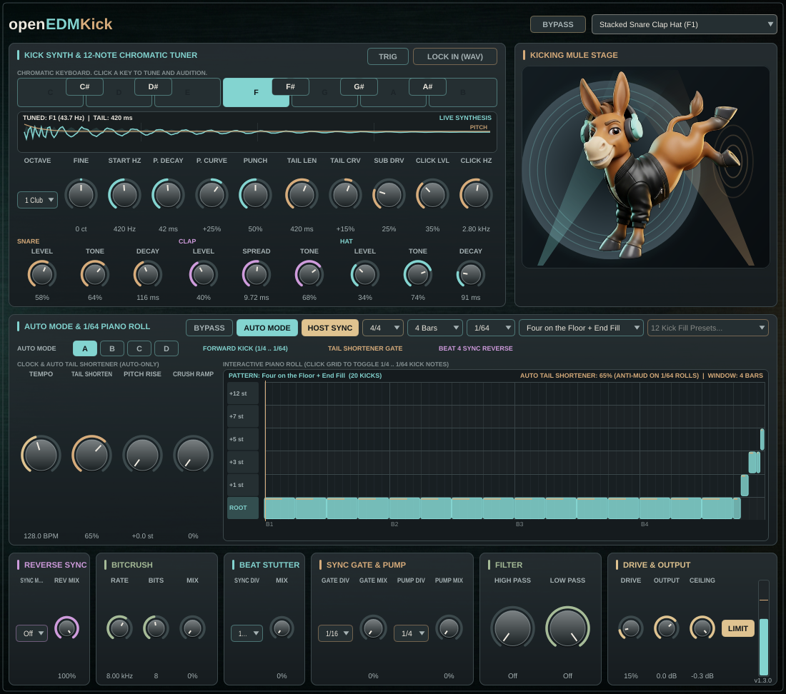
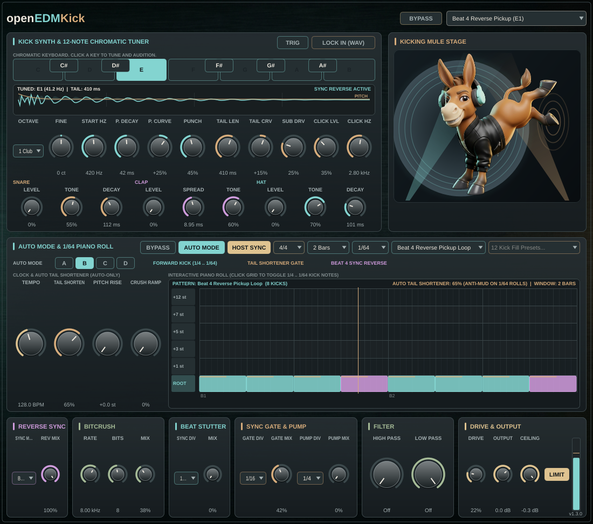

# Native UI screenshot



`assets/native-ui.png` shows the v1.3.0 native JUCE editor at 1100 × 972. It displays **Festival 1/64 Drop Rush** in **Auto Mode A** with the phrase forced to **1 Bar** so the 1/64 steps stay readable, **LOCK IN (WAV)** active, the chromatic keyboard on **F1**, the gold pitch-drop trace, the snare/clap/hat row at zero, high pass and low pass at Off, the output meter, and the Kicking Mule stage.



`assets/native-ui-layers.png` is the **Stacked Snare Clap Hat (F1)** preset, with each layer's level and modifiers visible.



`assets/native-ui-reverse.png` is **Beat 4 Reverse Pickup (E1)**, **Auto Mode B**, **2 Bars**, with the reverse pickup notes on beat 4. The preset menu shows that program.

Reproduce on a machine with a display (or `xvfb-run`) from the repository root:

```sh
cmake --build build --target openedmkick_plugin_tests --parallel
OEK_CAPTURE="$PWD/assets/native-ui.png" \
OEK_CAPTURE_REVERSE="$PWD/assets/native-ui-reverse.png" \
  ./build/openedmkick_plugin_tests '[ui]'
```
